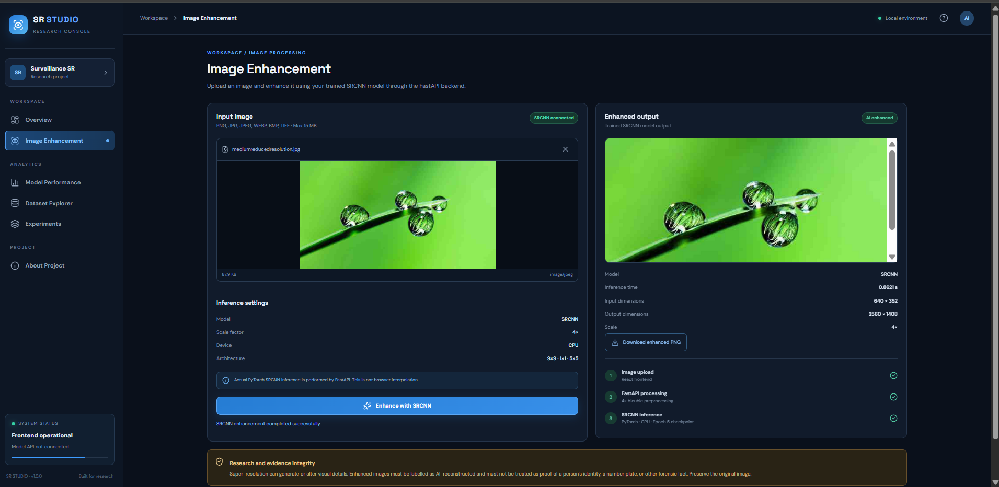
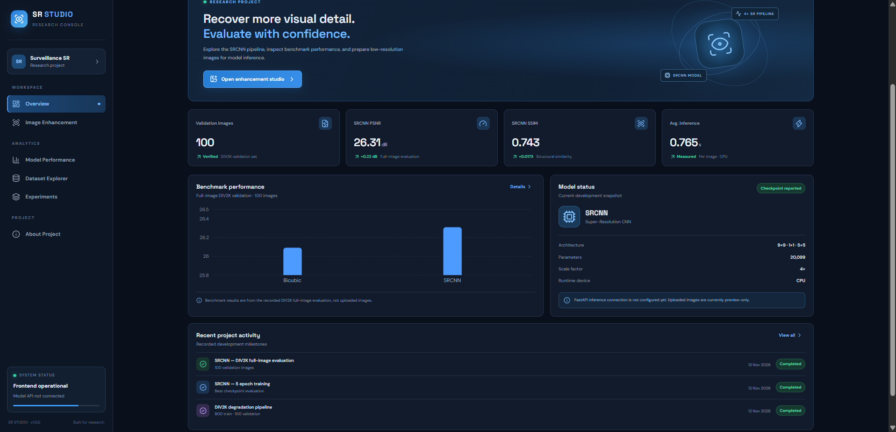
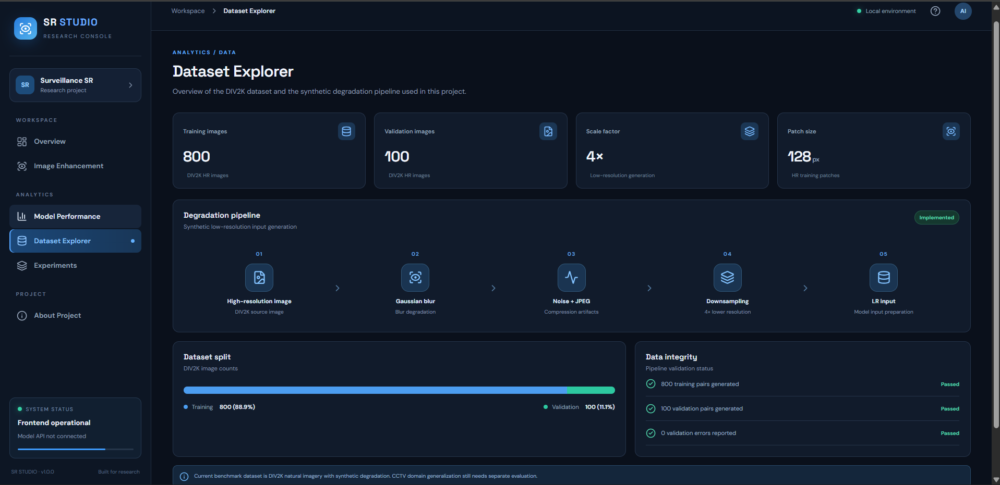
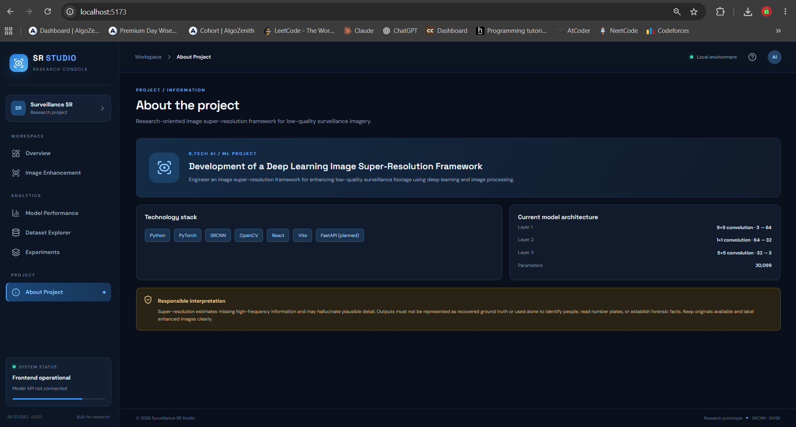

# Surveillance Image Super-Resolution Framework

A research-oriented deep-learning project for enhancing low-resolution images, with a focus on surveillance imagery.

> **Research integrity:** Super-resolution estimates missing high-frequency information and may generate plausible details. Enhanced images are AI-reconstructed outputs, not recovered ground truth. Preserve the original image; do not use enhanced outputs alone to identify people, read number plates, or establish forensic facts.

## Project status

- [x] DIV2K HR/LR dataset preparation with synthetic degradation
- [x] SRCNN model and patch-based training pipeline
- [x] SRCNN checkpoint and FastAPI inference integration
- [x] React + Vite image-enhancement interface
- [x] Full-image DIV2K validation evaluation
- [ ] SRGAN implementation and evaluation
- [ ] ESRGAN implementation and evaluation
- [ ] Video enhancement pipeline
- [ ] End-to-end comparison and final deployment

The current verified model is **SRCNN**. GAN models and video processing are planned work, not completed features.

## Current SRCNN architecture

| Layer | Operation | Channels |
|---|---|---:|
| 1 | 9×9 convolution + ReLU | 3 → 64 |
| 2 | 1×1 convolution + ReLU | 64 → 32 |
| 3 | 5×5 convolution | 32 → 3 |

- Scale factor: 4×
- Parameters: 20,099
- Runtime device in the current setup: CPU
- Training data: 800 DIV2K training HR/LR pairs
- Validation data: 100 DIV2K validation HR/LR pairs

## Current benchmark

Recorded full-image evaluation on 100 DIV2K validation images:

| Method | PSNR (dB) | SSIM |
|---|---:|---:|
| Bicubic baseline | 26.0917 | 0.7256 |
| SRCNN | 26.3103 | 0.7429 |
| Improvement | +0.2186 dB | +0.0173 |

Average SRCNN inference time recorded in the local CPU evaluation: approximately 0.765 seconds per image. Runtime depends on image dimensions and hardware.

These results are from DIV2K natural images with synthetic degradation. They do not establish performance on real CCTV footage; surveillance-domain evaluation remains necessary.

## Technology stack

- Python and PyTorch — model development and inference
- OpenCV and Pillow — image loading and processing
- FastAPI — inference API
- React and Vite — frontend
- DIV2K — training and validation benchmark

## Pipeline

1. Prepare high-resolution DIV2K images.
2. Generate paired low-resolution images using synthetic degradation (blur, noise, JPEG compression and 4× downsampling).
3. Extract aligned HR/LR training patches.
4. Bicubic-upsample LR patches to the HR input size.
5. Train SRCNN to reconstruct the cropped HR target.
6. Evaluate against the bicubic baseline using PSNR and SSIM.
7. Upload an image through the React interface.
8. FastAPI loads the trained SRCNN checkpoint, performs 4× bicubic preprocessing and tiled SRCNN inference, then returns a PNG result.

## Screenshots

### Image enhancement


### Dashboard and benchmark overview


### Dataset explorer


### Project information


## Run locally

### Backend

Activate your virtual environment, install the API requirements, then run:

```powershell
pip install -r api/requirements.txt
python -m uvicorn api.main:app --reload --host 127.0.0.1 --port 8000
```

### Frontend

In another terminal:

```powershell
cd app
npm install
npm run dev
```

Open the local Vite URL printed in the terminal.

## Repository notes

- Keep the Python virtual environment (`.venv/`), generated datasets (`data/`), and local model checkpoints (`checkpoints/`) out of Git unless there is a deliberate, documented reason to publish them.
- Do not commit API keys, credentials, local machine paths, or private data.
- Large datasets and model weights should be distributed separately (for example, through a suitable release or model-storage service), not as ordinary source files.
